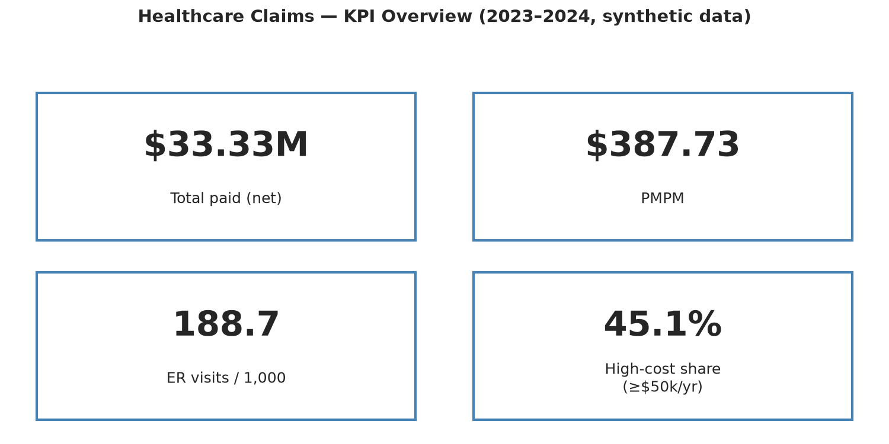
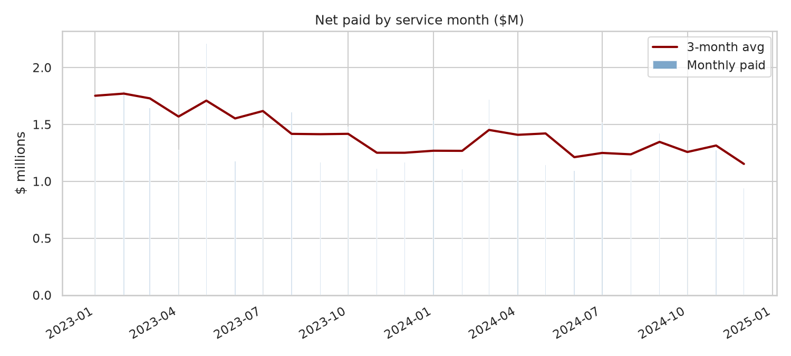
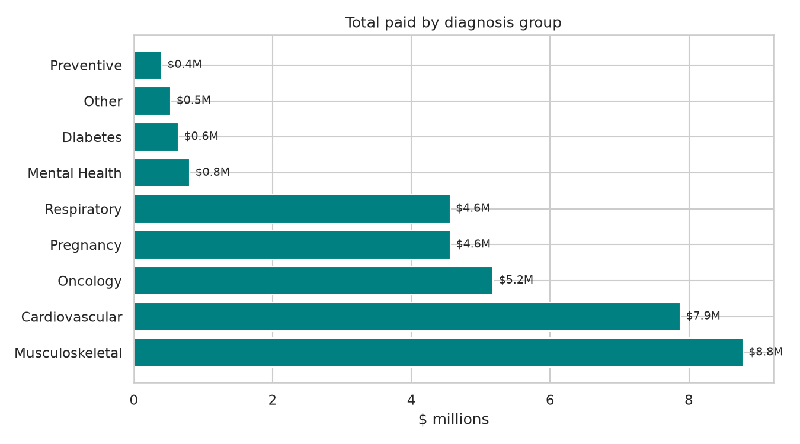
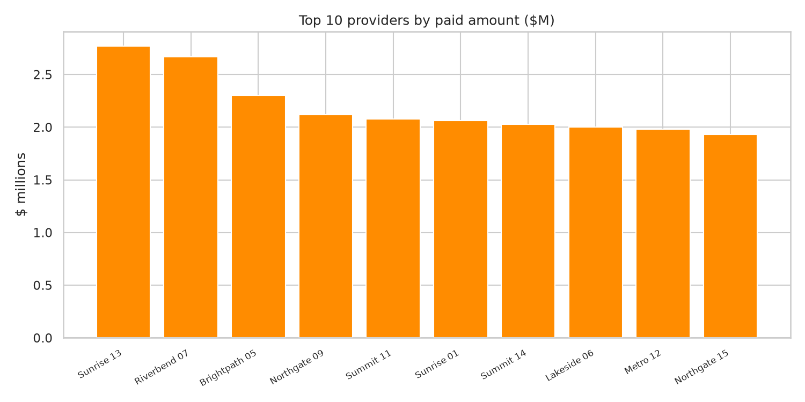

# Healthcare Claims Analytics

> **Portfolio project — 100% synthetic data.** Every row was generated with
> `src/generate_data.py` (seeded, `random_state=42`). The dataset contains
> **no real patient information** and is not affiliated with any payer,
> provider, or employer.

An end-to-end claims analysis answering the question every health plan asks:
**where is our medical spend going, and what can we do about it?**

## Business Problem

Healthcare spend is highly concentrated — a small share of members, providers,
and conditions drives most of the cost — but without a clean, governed view of
claims, cost-containment teams fly blind. This project builds that view:

- Quantify **unit cost (PMPM)** and its monthly trend
- Identify **cost drivers** by claim type, diagnosis group, and provider
- Measure **utilization** (ER visits per 1,000) and **spend concentration**
  (high-cost claimants, top-provider share) to size case-management and
  network-contracting opportunities

## Dataset

| File | Rows | Grain |
|---|---|---|
| `data/members.csv` | 4,000 | One row per member (demographics, plan type, enrollment window, member-months) |
| `data/providers.csv` | 120 | Provider master (hospitals, clinics, pharmacies, labs, specialty practices) |
| `data/claims.csv` | 15,023 | One row per claim, 2023-2024 (inpatient / outpatient / ER / pharmacy; diagnosis group; billed & paid amounts; paid / denied / adjusted status) |

Design notes: paid amounts are lognormal per claim type with ~1–2% catastrophic
claims, reproducing the real-world skew where a few high-cost cases dominate.
A small, documented set of data-quality issues (10 duplicate rows, 8 negative
adjustment amounts, 5 orphan provider keys) is intentionally included to
exercise the cleaning pipeline. Total size: 1.27 MB. See `data/README.md`.

## Objectives

1. Model the claims extract as a **star schema** (`dim_member`, `dim_provider`, `dim_date`, `fact_claims`)
2. Run a **data-quality battery** (duplicates, negative amounts, orphan keys, out-of-window dates) and clean reproducibly
3. Compute core health-plan KPIs: **PMPM**, **ER visits/1,000**, **high-cost claimant share**, **provider concentration**
4. Surface **cost drivers** by claim type and diagnosis group with an executive-ready summary

## Data Cleaning

Implemented in `src/data_cleaning.py`, demonstrated in the notebook:

| Issue found | Rows | Resolution |
|---|---|---|
| Duplicate `claim_id` rows | 10 | Removed, first occurrence kept |
| Negative `paid_amount` (claim adjustments) | 8 | Kept, flagged in `is_adjustment`; excluded from gross KPIs, included in net spend |
| Orphan `provider_id` (no master match) | 5 | Quarantined to a rejects frame for provider-master remediation |
| Null dates / null amounts | 0 | — |
| Paid > 2× billed (implausible) | 0 | — |

**15,008** clean claims proceed to analysis.

## Data Modeling

Star schema (full DDL in `sql/analysis_queries.sql`):

```
dim_member (member_id PK) ──┐
                            ├─► fact_claims (claim_id PK)
dim_provider (provider_id PK) ┘        │  measures: billed_amount, paid_amount
dim_date (date_key PK) ────────────────┘  degenerate dims: claim_type, diagnosis_group, claim_status
```

- `dim_member`: demographics, plan type, enrollment window, precomputed `member_months`
- `dim_provider`: provider master with type and specialty
- `dim_date`: derived from `service_date` (year / month / quarter)
- `fact_claims`: one row per claim; `is_adjustment` flag separates adjustments from gross spend

Foreign-key validation: 5 orphan provider keys quarantined at clean time; 0 orphan member keys.

## SQL Analysis

`sql/analysis_queries.sql` (SQLite-compatible) contains the DDL above plus:

1. **Monthly PMPM trend** — net paid per service month ÷ member-months
2. **Top 10 providers by paid amount**, each with share of total spend
3. **ER visits per 1,000 member-years**
4. **Average paid by diagnosis group** (cost-driver view)
5. **Spend skew** — inpatient share of claims vs. share of spend
6. **Data-quality checks** — duplicates, unflagged negatives, orphan provider/member keys, paid > 2× billed, out-of-window dates

## EDA

Key distributions (from `notebooks/analysis.ipynb`):

| Claim type | Claims | Share of claims | Total paid | Share of spend | Avg paid |
|---|---|---|---|---|---|
| Inpatient | 1,220 | 8.1% | $27.50M | 82.5% | $22,542 |
| ER | 1,351 | 9.0% | $2.74M | 8.2% | $2,026 |
| Outpatient | 8,229 | 54.8% | $2.63M | 7.9% | $319 |
| Pharmacy | 4,200 | 28.0% | $0.48M | 1.4% | $115 |

Monthly paid is stable around $1.3–1.5M/month with the expected noise; the 3-month
rolling average shows no alarming trend break over 2023–2024.

## Key Insights

1. **Inpatient care dominates spend**: 8.1% of claims drive **82.5%** of paid amounts — the classic claims skew. Cost containment starts here.
2. **Musculoskeletal ($8.78M, 26.3%) and Cardiovascular ($7.88M, 23.6%)** are the top diagnosis-group cost drivers — together ~50% of spend, the natural focus for care-management programs.
3. **High-cost claimants concentrate nearly half the spend**: 142 member-years (2.5%) with ≥$50k annual paid account for **45.1%** of total paid — the standard case-management target population.
4. **Provider spend is concentrated**: the top 10 providers (all hospitals) capture **65.8%** of spend; the largest single provider (Sunrise Medical Center 13) is 8.3% — leverage for network contracting.
5. **ER utilization is 188.7 visits per 1,000 member-years** — benchmark against plan targets; avoidable-ER analysis is the logical follow-up.

## Dashboard

KPI definitions: `dashboard/README.md`.









## Results & Metrics

All figures from the executed notebook, cleaned data, 2023–2024:

| Metric | Value |
|---|---|
| Members / member-months | 4,000 / 85,971 |
| Claims analyzed (clean) | 15,008 |
| Total paid (net) | **$33,333,392** |
| **PMPM (net)** | **$387.73** |
| ER visits / 1,000 member-years | 188.7 |
| Inpatient share of spend | 82.5% (from 8.1% of claims) |
| Top diagnosis group | Musculoskeletal — $8.78M (26.3%) |
| High-cost member-years (≥$50k/yr) | 142 (2.5%) → 45.1% of spend |
| Top-10 provider share of spend | 65.8% |

## Technologies Used

- **Python**: pandas, NumPy (analysis), matplotlib, seaborn (visualization)
- **SQL**: SQLite-compatible analytical queries + star-schema DDL
- **Data modeling**: star schema (`dim_member`, `dim_provider`, `dim_date`, `fact_claims`)
- **Jupyter**: executed end-to-end narrative (`notebooks/analysis.ipynb`)
- **Git**: versioned, reproducible pipeline (seeded data generation)

## How to Run

```bash
# 1. Create environment
python -m venv .venv && source .venv/bin/activate
pip install -r requirements.txt

# 2. (Re)generate the synthetic data — seeded, deterministic
python src/generate_data.py

# 3. Run the analysis notebook
jupyter nbconvert --to notebook --execute notebooks/analysis.ipynb \
  --output notebooks/analysis.ipynb --allow-errors

# 4. Or use the modules directly
python -c "
import sys; sys.path.insert(0, 'src')
from analysis import load_data
from data_cleaning import clean_claims
d = load_data()
print(clean_claims(d['claims'], d['providers'])['dq_report'])"
```

## Resume-Ready Description

> Built an end-to-end healthcare claims analytics project on synthetic data (4K members, 15K claims): modeled a star schema, ran data-quality checks and cleaning in Python, computed PMPM ($387.73), ER utilization, and spend-concentration KPIs with SQL and pandas, and identified inpatient care (82.5% of spend from 8.1% of claims) and musculoskeletal/cardiovascular conditions as top cost drivers.
